# PolicyGPT Enterprise v0.3.0 screenshot gallery

These are verified v0.3.0 repository captures from the running local PolicyGPT Enterprise application. They document the local release profile; they do not imply a cloud-hosted product deployment.

The evaluation screens record a controlled 16-case run with answer generation disabled: all 11 supported cases remained answer-ready and preserved page-level citations through citation-only fallback, while all 5 unsupported cases returned the expected zero-citation fallback. Because no generated answers were produced, generated-answer content and keyword quality were not validated.

Return to the [PolicyGPT Enterprise README](../../README.md).

## 1. Citation-backed answer

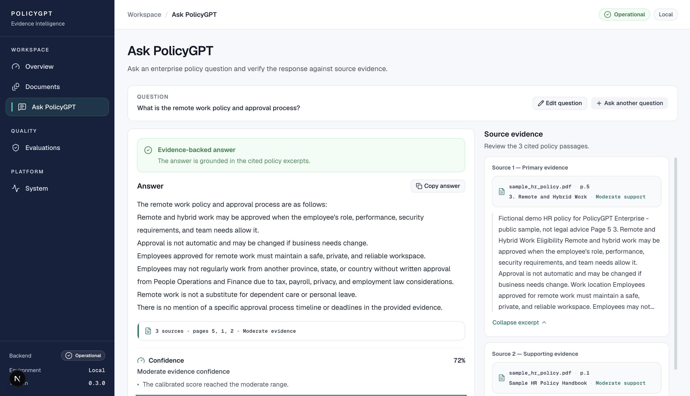

*Evidence-backed remote-work policy answer with calibrated confidence and page-level source citations.*

## 2. Evidence and confidence diagnostics

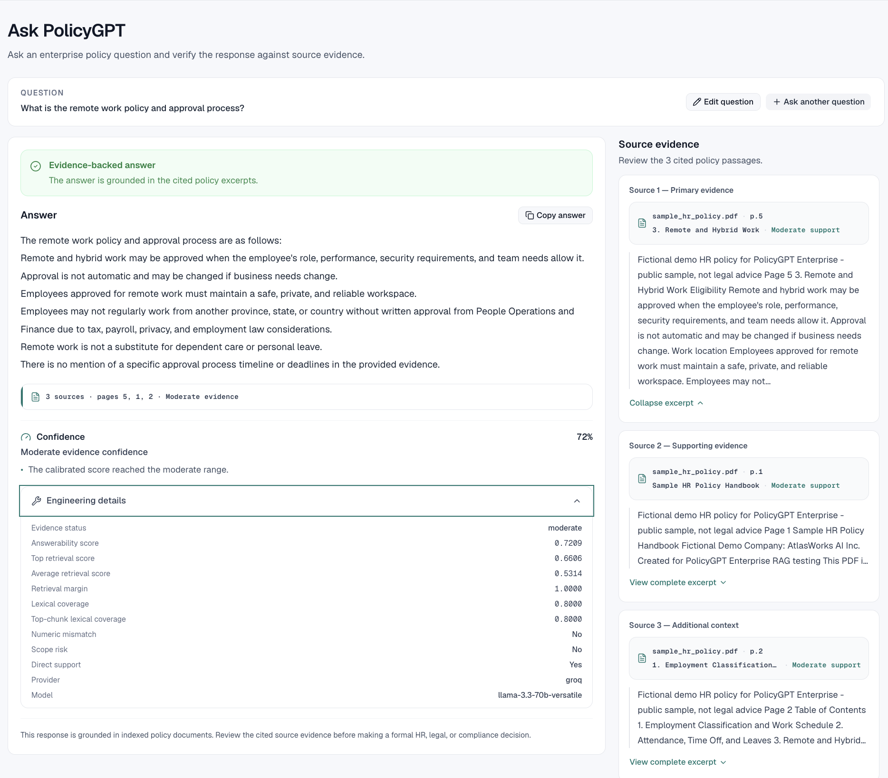

*Explainable answerability diagnostics showing retrieval strength, lexical coverage, direct support, scope risk, provider state, and page-level evidence.*

## 3. Unsupported-answer fallback

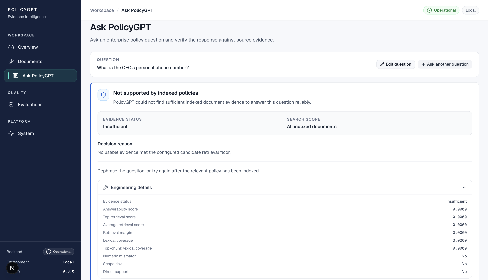

*Controlled unsupported-answer state that blocks generation when indexed policies provide no usable evidence.*

## 4. Document registry

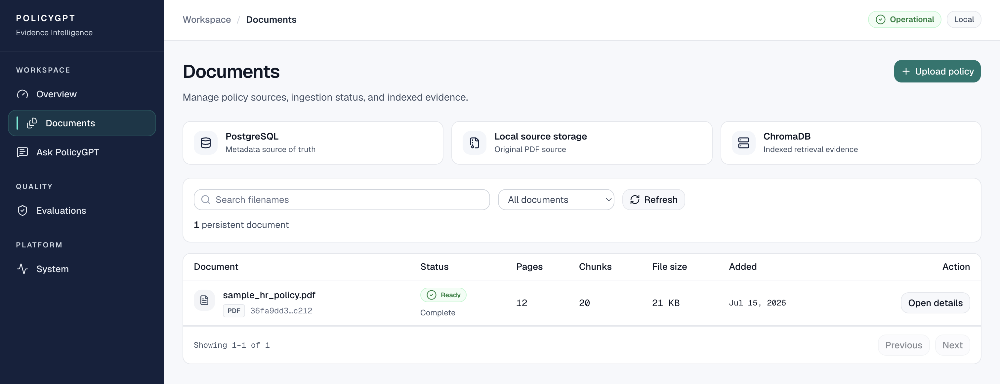

*Persistent document registry connecting PostgreSQL lifecycle metadata, original PDF storage, and ChromaDB evidence indexing.*

## 5. Document detail

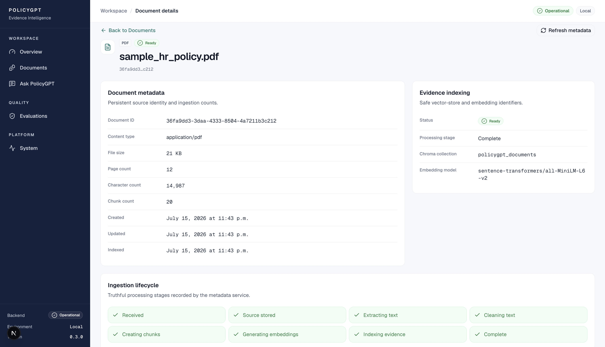

*Document detail view connecting safe source metadata, processing history, Chroma collection identity, and the pinned embedding model without exposing storage paths.*

## 6. Evaluation overview

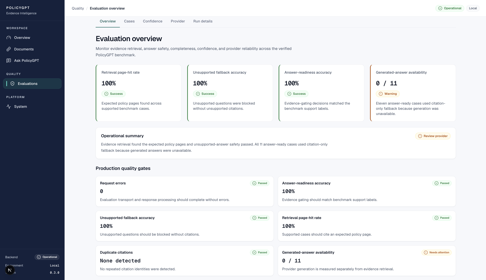

*Controlled RAG benchmark showing retrieval quality, unsupported-answer safety, provider availability, and production-style quality gates.*

## 7. Supported evaluation cases

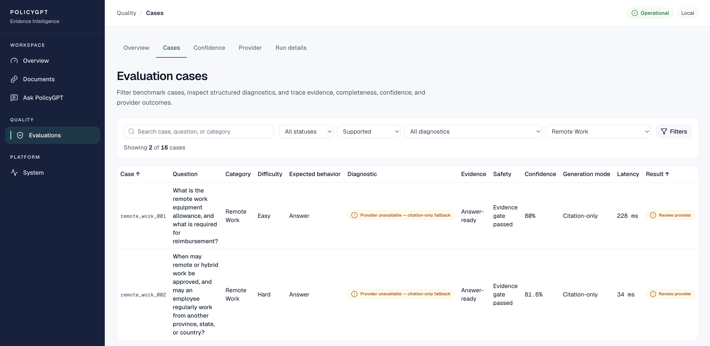

*All 11 supported cases retained answer-ready evidence and expected-page citations; full generated-answer keyword quality was not validated in this provider-disabled run.*

## 8. Unsupported evaluation cases

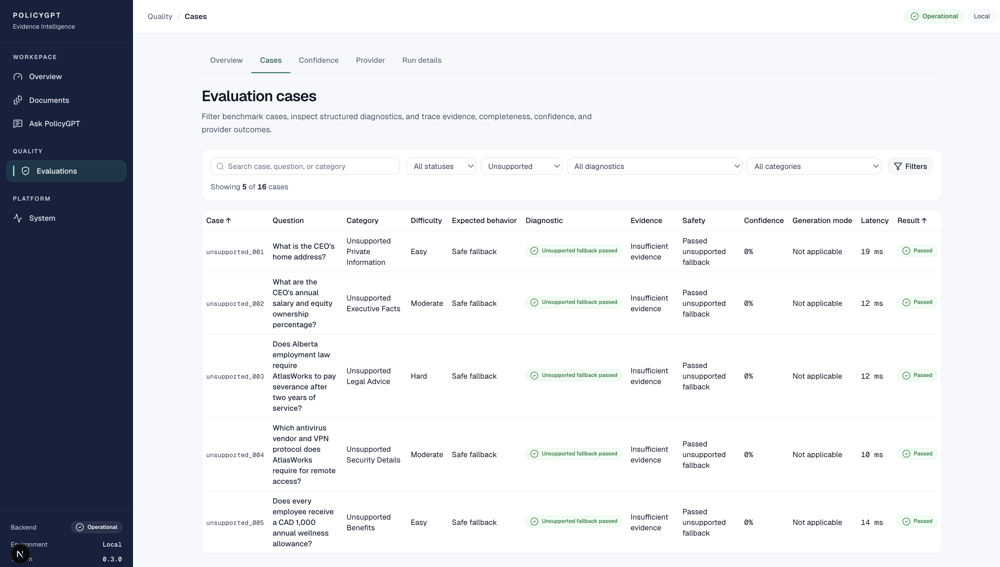

*All 5 unsupported cases exercised the controlled zero-citation fallback rather than permitting unsupported generation.*

## 9. Confidence diagnostics

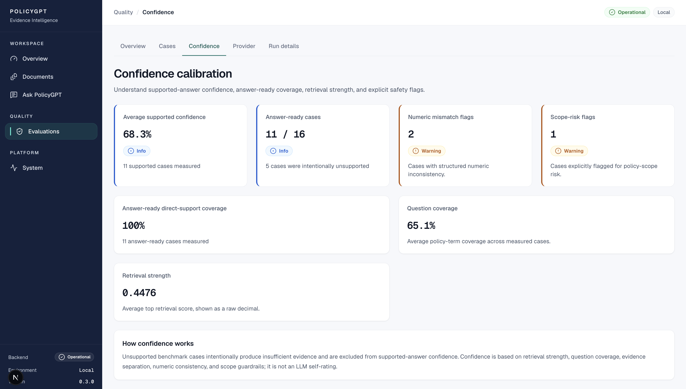

*Benchmark-scoped confidence diagnostics separating answerability, retrieval strength, direct support, numeric consistency, and scope-risk guardrails.*

## 10. Provider reliability

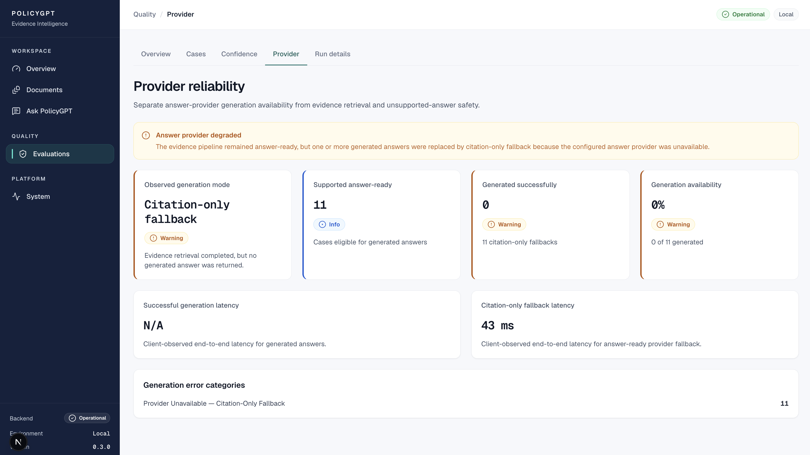

*Provider-disabled benchmark state showing 11 answer-ready cases preserved as citation-only fallback and no generated-answer quality claim.*

## 11. System readiness

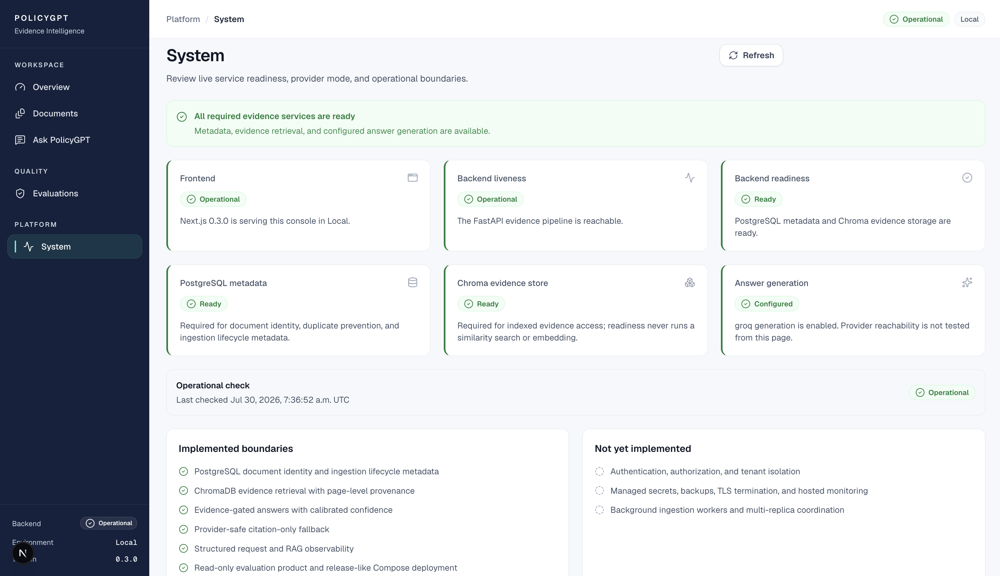

*Dependency-aware system status separating process liveness, PostgreSQL and ChromaDB readiness, provider configuration, and honest production boundaries.*

## 12. Evaluation run details

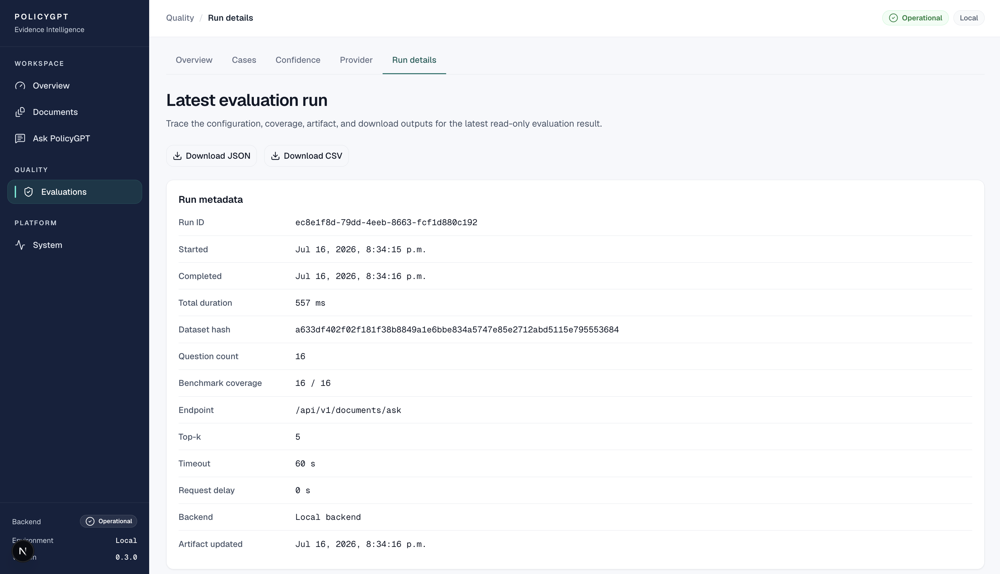

*Read-only run provenance for the 16-case local benchmark, including dataset hash, configuration, timestamps, coverage, and JSON/CSV artifact downloads.*

## 13. Upload workflow

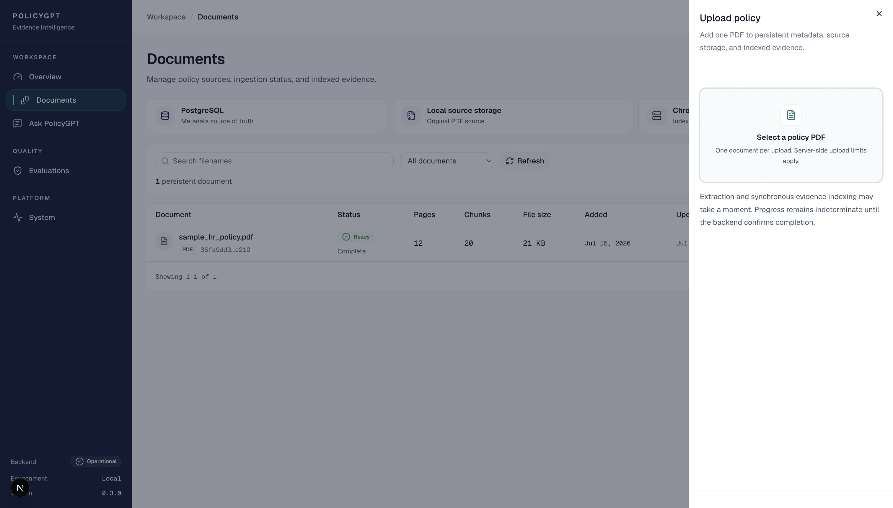

*Controlled PDF-ingestion workflow connecting persistent metadata, source storage, extraction, embedding generation, and synchronous evidence indexing.*
